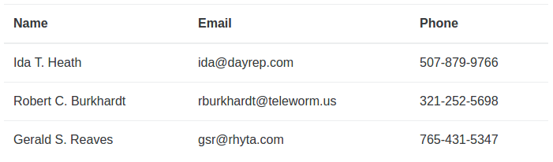

# ``Matreshka.Array`` class example



This example explains a purpose of [Matreshka.Array](https://matreshka.js.org/#Matreshka.Array). Before reading you need to be familiar with ``Matreshka.Object``. A short tutorial about the usage of ``Matreshka.Object``  [lives there](https://github.com/finom/matreshka/tree/main/examples/matreshka-object).

Let’s say the task is to display a list of some people as a table. So as not to make the example more complicated, let’s place the prepared data into ``data`` variable.

```js
// randomly generated names and phones
const data = [{
        name: 'Ida T. Heath',
        email: 'ida@dayrep.com',
        phone: '507-879-9766'
    }, {
        name: 'Robert C. Burkhardt',
        email: 'rburkhardt@teleworm.us',
        phone: '321-252-5698'
    }, {
        name: 'Gerald S. Reaves',
        email: 'gsr@rhyta.com',
        phone: '765-431-5347'
}];
```

At the beginning, as usual, let’s create HTML layout.

```html
<table class="users">
  <thead>
    <th>Name</th>
    <th>Email</th>
    <th>Phone</th>
  </thead>
  <tbody><!-- the list of users will be here --></tbody>
</table>
```

Declare Users collection which is inherited from ``Matreshka.Array``.

```js
class Users extends Matreshka.Array {

}
```

Define ``"itemRenderer"`` property which is responsible for the way the elements of the array will be rendered on the page.

```js
get itemRenderer() {
    return '#user_template';
}
```

In this case, the selector, referring to a template in HTML code, has been given as a value.

```html
<script type="text/html" id="user_template">
 <tr>
   <td class="name"></td>
   <td class="email"></td>
   <td class="phone"></td>
  </tr>
</script>
```

> ``itemRenderer`` property can get other values, including function or HTML string.

And set the value of ``Model`` property, defining the class of elements which are contained in the collection.

```js
get Model() {
    return User;
}
```

We will create ``User`` class a bit later, let’s define the constructor of the newly-created collection class first.

```js
constructor(data) {
    super();
    this
        .bindNode("sandbox", ".users")
        .bindNode("container", ":sandbox tbody")
        .recreate(data);
}
```

While creating the instance class:

- ``sandbox`` property is bound to ``.users`` element creating a sandbox (class boundary effect on HTML).
- ``container`` property is bound to ``:sandbox tbody`` element determining HTML node where the rendered array items will be inserted into.
- Add the passed data to the array with the help of [recreate](https://matreshka.js.org/#Matreshka.Array-recreate) method.

That's good enough. But we're going to use all the awesomeness of ECMAScript 2015 and we're going to use ``super`` call to fill the collection with passed data.

```js
constructor(data) {
    super(...data)
        .bindNode('sandbox', '.users')
        .bindNode('container', ':sandbox tbody')
        .rerender();
}
```
- Add new items to the collecton via ``super`` call (which does the same as ``Matreshka.Array.apply(this, data)`` would do).
- ``sandbox`` property is bound to ``.users`` element creating a sandbox.
- ``container`` property is bound to ``:sandbox tbody`` element.
- Call [rerender](https://matreshka.js.org/#Matreshka.Array-rerender) method to render the collection (since we've bound ``container`` later than added new items).

Now declare a "model". ``User`` class is inherited from the familiar ``Matreshka.Object``.

```js
class User extends Matreshka.Object {
    constructor(data) { ... }
}
```

Set in the data passed to the constructor with the help of [setData](https://matreshka.js.org/#Matreshka.Object-setData) method or, as we always do, set the data via ``super`` call.

```js
super(data);
```

Next, wait for ``"render"`` event which only fires out when the corresponding HTML element has been created but it hasn’t been inserted into the page yet. Bind the relevant properties to the corresponding HTML elements in the handler. When the property value is changed, ``innerHTML`` of the set element will be changed as well.

```js
this.on('render', () => {
    this.bindNode({
        name: ':sandbox .name',
        email: ':sandbox .email',
        phone: ':sandbox .phone'
    }, Matreshka.binders.html());
});
```

There is also an option to listen for ``"render"`` event via creating a special virtual method for a model called ``onRender`` (check out [the doc](https://matreshka.js.org/#Matreshka.Array-onItemRender)) but for demonstrational purposes let's simply use [on method](https://matreshka.js.org/#Matreshka-on) call.

In the end, create the instance of ``Users`` class, having passed the data as an argument.

```js
const users = new Users(data);
```

That’s it. On page reloading you will see a table with the list of users.

[**Demo**](https://matreshka.js.org/examples/matreshka-array/)

Now open the dev console and type:
```js
users.push({
  name: "Gene L. Bailey",
  email: "bailey@rhyta.com",
  phone: "562–657–0985"
});
```

As you see, a new element has been added to the table. And now call:
```js
users.reverse();
```

or any other array method (``sort``, ``splice``, ``pop``...). Besides its own methods, ``Matreshka.Array`` contains all the methods of a JavaScript array without any exception. Then,

```js
users[0].name = "Vasily Pupkin";
users[1].email = "mail@example.com";
```

As you see, you don’t have to watch changes in the collection manually, the framework catches data changes and alters DOM by itself. It’s incredibly convenient.

Remember, ``Matreshka.Array`` supports its own set of events. You can catch any change in the collection: adding, deleting, re-sorting of elements with the help of [on method](https://matreshka.js.org/#Matreshka-on).

```js
users.on("addone", evt => {
    console.log(evt.addedItem.name);
});
users.push({
    name: "Clint A. Barnes"
});
```

(it will print the name of the added user in the console)

-------------------------------

As it's said at [the documentation for itemRenderer](https://matreshka.js.org/#Matreshka.Array-itemRenderer) you're able to define the item renderer on ``Model`` class level. This is the answer on a frequently asked question "why should I declare a renderer on the collection level". Instead of using ``itemRenderer`` you can define ``renderer`` property for the ``Model`` class.

```js
class User extends Matreshka.Object {
    get renderer() {
        return '#user_template';
    }
    constructor(data) { ... }
}
```


There are more ways to make such application: you don't actually have to define a model class if it does not contain any serious logic. There is an example of the same application but using only single class:

```js
class Users extends Matreshka.Array {
    get itemRenderer() {
        return '#user_template';
    }
    constructor(data) {
        super(...data)
            .bindNode('sandbox', '.users')
            .bindNode('container', ':sandbox tbody')
            .rerender();
    }
    onItemRender(item) {
        // item is a simple object so we're going to use
        // a static version of bindNode
        Matreshka.bindNode(item, {
            name: ':sandbox .name',
            email: ':sandbox .email',
            phone: ':sandbox .phone'
        }, Matreshka.binders.html());
    }
}
```

Also you can use [a bindings parser](https://matreshka.js.org/#Matreshka-parseBindings) which is turned on by default at ``Matreshka.Array`` class and declare the item renderer inside the class and don't define any templates at HTML code.

```js
class Users extends Matreshka.Array {
    get itemRenderer() {
        return `
        <tr>
          <td class="name">{{name}}</td>
          <td class="email">{{email}}</td>
          <td class="phone">{{phone}}</td>
        </tr>`;
    }
    constructor(data) {
        super(...data)
            .bindNode('sandbox', '.users')
            .bindNode('container', ':sandbox tbody')
    }
}
```
